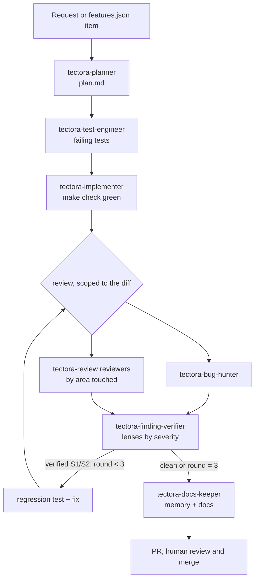

# Agent workflow

How the AI agents in this repository divide work, hand it off and check each
other. Adopted from `jakubkodajek/dev_template` and fitted to Tectora: roof
logic is proven against DACAD, MCP parity is a rule, and the reviewers of
`tectora-review` do the review step.

## Principles

1. **Separation of duties.** Planning, testing, implementing, reviewing and
   verifying run in different subagents with fresh contexts; a reviewer that
   did not write the code is not biased toward it (Claude Code best
   practices, https://code.claude.com/docs/en/best-practices).
2. **Test first, by a different agent.** `tectora-test-engineer` writes
   failing tests; `tectora-implementer` may not edit them.
3. **DACAD is the oracle.** Roof logic is right when it equals DACAD's
   output on a fixture, not when it looks right (`AGENTS.md`, ADR-0003).
4. **Find, verify, rank.** Reviewers report in parallel; independent
   verifiers try to refute every serious finding before anyone fixes it (the
   structure of Anthropic's `code-review` plugin,
   https://github.com/anthropics/claude-plugins-official/tree/main/plugins/code-review).
5. **Bounded fix loop.** Fix, re-review, re-verify, at most 3 rounds, then a
   human decides (evaluator-optimizer pattern, Anthropic "Building effective
   agents", https://www.anthropic.com/engineering/building-effective-agents).
6. **Evidence, not claims.** Every report carries the commands and their
   output; `make check` is the gate.
7. **Deterministic guardrails.** What must never happen (force push, DACAD
   material in git, edits of lockfiles or generated files) is blocked by
   hooks and CI, not only by prompts (hooks are deterministic,
   https://code.claude.com/docs/en/hooks).
8. **State on disk.** Progress lives in `memory/` and git so a fresh session
   can resume (Anthropic, "Effective harnesses for long-running agents",
   https://www.anthropic.com/engineering/effective-harnesses-for-long-running-agents).

## Roles

| agent | writes to | model | purpose |
| --- | --- | --- | --- |
| `tectora-planner` | `target/work/`, `docs/adr/` | opus | layers touched, DACAD evidence, acceptance criteria, test plan, risks |
| `tectora-test-engineer` | tests and fixtures | sonnet | failing tests first; regression tests for confirmed bugs |
| `tectora-implementer` | `crates/`, `app/` | sonnet | make the tests pass across core, MCP, Tauri, ui_bridge, UI, i18n |
| `tectora-bug-hunter` | `target/work/` | sonnet | runs hostile inputs; keeps only reproduced failures |
| `tectora-ux-reviewer`, `tectora-ui-reviewer`, `tectora-math-reviewer`, `tectora-arch-reviewer`, `tectora-test-reviewer`, `tectora-error-hunter` | `target/review/<run>/` | inherit | read-only review by area (`tectora-review`) |
| `tectora-finding-verifier` | nothing (returns a verdict) | inherit | tries to disprove one finding through one lens |
| `tectora-docs-keeper` | `memory/`, docs | haiku | progress, decisions, lessons, feature status, ROADMAP |

Model choices are defaults: stronger models where judgment matters
(planning), cheaper ones for routine work. Change `model:` per agent.

## Pipeline (`tectora-feature`)



Other entry points: `tectora-review` (audit without building),
`tectora-bug-hunt` (break one area), `tectora-test` (test a change end to
end), `tectora-dacad-parity` (roof logic against DACAD), `tectora-handoff`
(end a session).

## Scratch folders

Both are under `target/`, which git ignores.

| folder | producer | consumer |
| --- | --- | --- |
| `target/work/<slug>/plan.md` | planner | everyone |
| `target/work/<slug>/attacks.md`, `repro/`, `findings-bugs.md` | bug hunter | verifiers, test engineer |
| `target/review/<run>/*.md`, `shots/`, `verify/`, `summary.md` | reviewers, verifiers (`board.md`) | implementer, human |

Anything worth keeping goes to `memory/` or `docs/` through the docs keeper.

## Handoff report

Every subagent ends with this; the orchestrator keeps only this, not the
transcript.

```markdown
### Handoff: <agent> - <slug>
- **Status:** done | blocked | needs-decision
- **Summary:** 1-3 sentences
- **Artifacts:** paths written
- **Evidence:** commands run + relevant output (trimmed)
- **Findings:** count by severity, or n/a
- **Open questions / next step:**
```

Severities are S1-S4 everywhere (`REVIEW.md`, `tectora-test`, `board.md`).

## Cross-tool mapping

| concept | Claude Code | OpenAI Codex | GitHub Copilot |
| --- | --- | --- | --- |
| project instructions | `CLAUDE.md` (imports `AGENTS.md`) | `AGENTS.md` | `AGENTS.md`, `.github/copilot-instructions.md` |
| subagents | `.claude/agents/*.md` (source) | `.codex/agents/*.toml` (generated) | `.github/agents/*.agent.md` (generated) |
| skills | `.claude/skills/*/SKILL.md` (source) | `.agents/skills/` (generated) | - |
| guardrails | `.claude/settings.json` hooks | sandbox and approval policy | repository rulesets |

Edit only the sources, then `python3 scripts/sync_agents.py`; CI fails when
the generated copies are stale. Claude-only frontmatter (`tools:`, `model:`)
is not carried over, so Codex and Copilot rely on their own sandbox settings.

## Cost

Multi-agent runs use many more tokens than one chat; Anthropic measured
about 15x for their research system
(https://www.anthropic.com/engineering/multi-agent-research-system). Use
`tectora-feature` for real features; for a small fix implement it directly,
run `make check`, and run `tectora-review` on the diff once.
