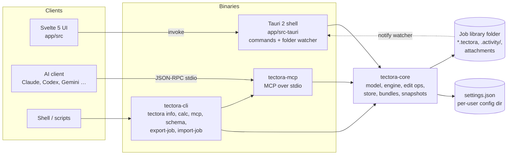
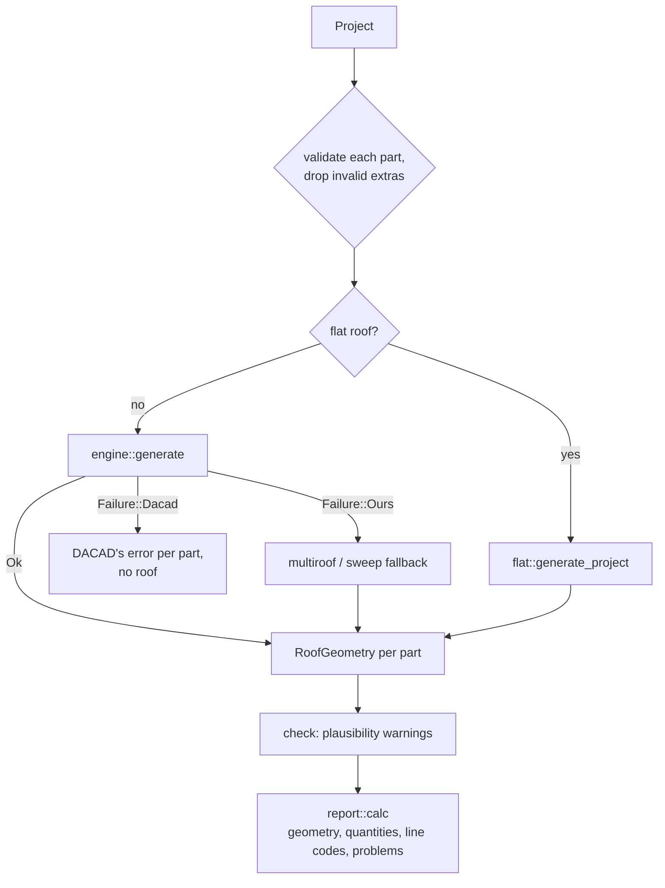
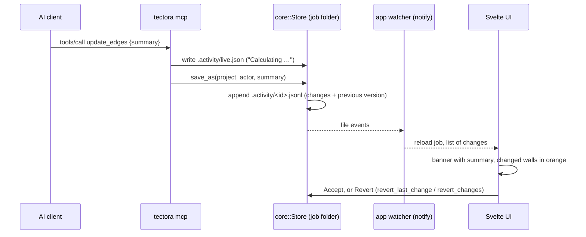

# Architecture

Tectora is one Rust workspace with three front ends over one core. Every roof
number comes from `tectora-core`; the desktop app, the CLI and the MCP server
only call it. This file is the map; the details live in the module docs
(`//!` at the top of each file) and in the documents linked below.

The installed app binary is also the MCP server: `Tectora mcp` serves MCP on
stdin/stdout and opens no window (`app/src-tauri/src/main.rs`).

## Crates and folders

| path | role | depends on |
| --- | --- | --- |
| `crates/tectora-core` | everything about roofs and jobs; pure and deterministic | `serde`, `geo`, `schemars`, `zip`, `dirs` |
| `crates/tectora-mcp` | MCP server: tool schemas, dispatch, `guide.md` for AI clients | core |
| `crates/tectora-cli` | the `tectora` binary (clap) | core, mcp |
| `app/src-tauri` | Tauri commands over the core, folder watcher, single instance, file associations | core, mcp, `notify`, Tauri plugins |
| `app/src` | Svelte 5 + TypeScript UI, three.js 3D, translations, theme tokens | Tauri API only |
| `tests/fixtures` | DACAD's own outputs the core is checked against | |
| `integrations/skills/tectora-roof` | skill end users give their AI client for drawing-to-roof | MCP tools |

No roof math lives in TypeScript. `app/src/lib/api.ts` is the only place the
UI talks to the backend.

## Inside `tectora-core`

| module | what it does |
| --- | --- |
| `model` | `Project` and its parts, walls (`EdgeDef`), dormers, chimneys, windows, openings, job info; validation, limits (`MAX_COORD`), `guarded` (catch panics), JSON schema |
| `walls` | chains DACAD-style wall lists into closed roof parts and open dormer polylines |
| `engine` | the main path: project → DACAD RD2 → `dcore` → core SOL (one roof) or core SOL + INT + W3D → `modell` (several roofs) → `RoofGeometry` per part |
| `dcore/` | 1:1 port of DACAD's roof core, validated against an emulator of the original (`dcore/PORTING.md`) |
| `modell/` | port of DACAD's Modellverschnitt, which joins several roofs; float32 quirks kept on purpose |
| `coresol/` | DACAD's intermediate files: RD2 reader, core SOL, INT and W3D writers |
| `roof`, `raised`, `union`, `multiroof`, `gable_wall` | Tectora's own weighted straight-skeleton sweep engine, used only when the core path fails for a reason of ours |
| `openings`, `dormer`, `flat` | windows, chimneys, openings, dormers and flat roofs applied as DACAD does; `openings::generate_project` is the entry point for every caller |
| `check` | plausibility warnings for roofs that are DACAD-identical but geometrically odd |
| `quantities`, `report` | quantities by DACAD line code and by material; `report::calc` builds what the UI, CLI and MCP show |
| `edit/` | editor operations shared by the UI and MCP: dormer kinds, transforms, round roof, calculation helpers, returning `Patches` |
| `store` | the job library: one `.tectora` per job, attachments, activity log with previous versions, `live.json` |
| `bundle`, `snapshot`, `diff`, `settings`, `examples` | `.tectorajob` ZIPs, stored result, change lists for review, user settings, example gallery |

## Calculation pipeline

Entry point: `openings::generate_project` (`crates/tectora-core/src/openings.rs`).
A `Failure::Dacad` is a result, not a bug: DACAD ends with the same error.
How the core is proven: `docs/core-verification.md` (fixtures, closed forms,
invariants, properties) and `dcore/PORTING.md` (emulator).

## Job library and live AI review

The library folder is `$TECTORA_PROJECTS_DIR` or `Documents/Tectora`;
settings are in the per-user config folder (`TECTORA_CONFIG_DIR` overrides
it). Details: `docs/ai-integration.md`, `crates/tectora-core/src/store.rs`.

## Files

| file | format | written by |
| --- | --- | --- |
| `*.tectora` | JSON, `docs/tectora.schema.json`, versioned with migrations on load, newer neither read nor overwritten | core `store` |
| `*.tectorajob` | ZIP: `manifest.json`, `project.tectora`, `history.jsonl`, `preview.svg`, `files/` | core `bundle` |
| `.activity/<id>.jsonl`, `.activity/live.json` | change log with previous versions; current AI activity | core `store`, MCP |
| `settings.json` | user settings, unknown keys kept | core `settings` |

All of them are untrusted input: ids, sizes and coordinate ranges are checked
before anything is calculated or written, and calculations run inside
`model::guarded`. PDF drawings (MCP drawing tools) are read in a child
process of the same executable with a heap cap and a time limit
(`tectora-mcp/src/worker.rs`), because the PDF reader itself has no limit
on inflated streams or nested forms.

## Development and CI

- Browser preview: `npm run preview` runs `crates/tectora-core/examples/ui_bridge.rs`
  (the Tauri commands over a real library in `target/ui-preview-library`)
  with Vite and `app/src/dev/tauri-mock.ts`. A new Tauri command must be
  added there too.
- `.github/workflows/build.yml`: tests on Ubuntu, then macOS universal
  `.dmg` and Windows NSIS `.exe`; `release.yml` publishes signed installers
  and the in-app update from an annotated tag `v<version>`
  (`docs/releasing.md`). `e2e.yml` runs the Playwright suite in `app/e2e`.
- `.github/workflows/core-stress.yml`: nightly property and invariant tests
  with 20 000 cases.
- `.github/workflows/agent-config.yml`: agent files in sync, hooks behave,
  JSON valid.

## Key decisions

`docs/adr/` (ADR-0002 stack, ADR-0003 DACAD core as engine) and
`memory/decisions.md`.
