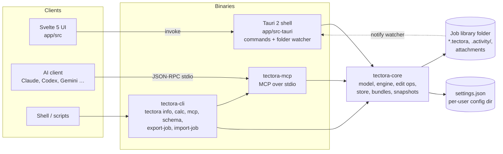
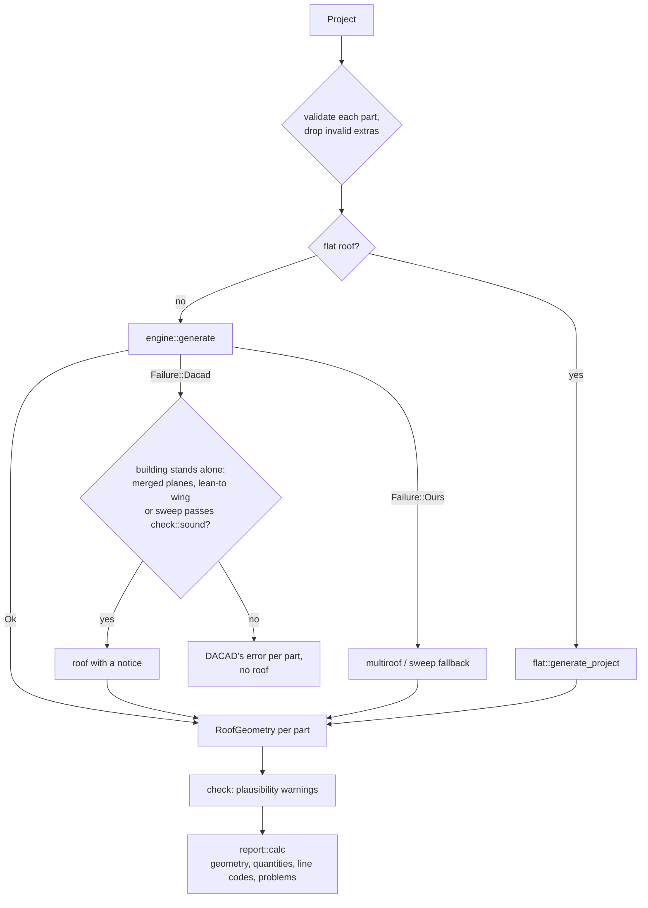
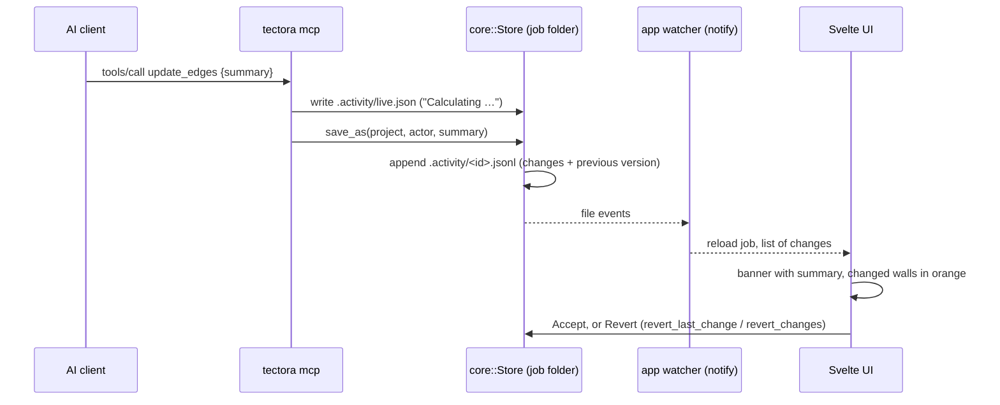

# Architecture

Tectora is one Rust workspace with three front ends over one core. Every roof
number comes from `tectora-core`; the desktop app, the CLI and the MCP server
only call it. This file is the map; the details live in the module docs
(`//!` at the top of each file) and in the documents linked below.

The installed app binary is also the MCP server: `Tectora mcp` serves MCP on
stdin/stdout and opens no window (`app/src-tauri/src/main.rs`).

## Crates and folders

| path | role | depends on |
| --- | --- | --- |
| `crates/tectora-core` | everything about roofs and jobs; pure and deterministic | `serde`, `geo`, `schemars`, `zip`, `dirs` |
| `crates/tectora-mcp` | MCP server: tool schemas, dispatch, `guide.md` for AI clients | core |
| `crates/tectora-cli` | the `tectora` binary (clap) | core, mcp |
| `app/src-tauri` | Tauri commands over the core, folder watcher, single instance, file associations | core, mcp, `notify`, Tauri plugins |
| `app/src` | Svelte 5 + TypeScript UI, three.js 3D, translations, theme tokens | Tauri API only |
| `tests/fixtures` | DACAD's own outputs the core is checked against | |
| `integrations/skills/tectora-roof` | skill end users give their AI client for drawing-to-roof | MCP tools |

No roof math lives in TypeScript. `app/src/lib/api.ts` is the only place the
UI talks to the backend. Every committed edit (a dialog's OK, a typed field, a
click that creates something) is an `edit/` operation behind a command in
`commands.rs`; forms show live figures by asking the core after a short pause
(`lib/latest.ts`, newest answer wins). What stays in TypeScript is
presentation that must answer during a pointer drag or draws calculated data,
and the migration of the older copies is not finished: ADR-0005 lists what
moved, what stays and why, and what is still to move (`transform.ts`,
`dormers.ts`, `corners.ts`), with `editparity.test.ts` guarding the copies that
remain.

## Inside `tectora-core`

| module | what it does |
| --- | --- |
| `model` | `Project` and its parts, walls (`EdgeDef`), dormers, chimneys, windows, openings, job info; validation, limits (`MAX_COORD`), `guarded` (catch panics), JSON schema |
| `walls` | chains DACAD-style wall lists into closed roof parts and open dormer polylines |
| `engine` | the main path: project → DACAD RD2 → `dcore` → core SOL (one roof) or core SOL + INT + W3D → `modell` (several roofs) → `RoofGeometry` per part |
| `dcore/` | 1:1 port of DACAD's roof core, validated against an emulator of the original (`dcore/PORTING.md`) |
| `modell/` | port of DACAD's Modellverschnitt, which joins several roofs; float32 quirks kept on purpose |
| `coresol/` | DACAD's intermediate files: RD2 reader, core SOL, INT and W3D writers |
| `roof`, `raised`, `union`, `multiroof`, `gable_wall` | Tectora's own weighted straight-skeleton sweep engine, used only when the core path fails for a reason of ours |
| `openings`, `dormer`, `flat` | windows, chimneys, openings, dormers and flat roofs applied as DACAD does; `openings::generate_project` is the entry point for every caller |
| `check` | plausibility warnings for roofs that are DACAD-identical but geometrically odd; `check::sound`, the self-check every departure from the core's result must pass |
| `coplanar`, `wing_split` | the two departures tried where the core stops: parallel planes joined into one face, a low wing calculated as a lean-to against the house wall |
| `quantities`, `report` | quantities by DACAD line code and by material; `report::calc` builds what the UI, CLI and MCP show |
| `edit/` | editor operations shared by the UI and MCP: dormer kinds, transforms, round roof, calculation helpers (`edit::helper` is the one entry the dialog and MCP `roof_helper` call), returning `Patches` |
| `commands` | the bodies of the app's Tauri commands (calc, helpers, shape operations), shared with the browser preview's bridge and tested in the core crate |
| `store` | the job library: one `.tectora` per job, attachments, activity log with previous versions, `live.json` |
| `bundle`, `snapshot`, `diff`, `settings`, `examples` | `.tectorajob` ZIPs, stored result, change lists for review, user settings, example gallery |

## Calculation pipeline

Entry point: `openings::generate_project` (`crates/tectora-core/src/openings.rs`).
A `Failure::Dacad` is a result, not a bug: DACAD ends with the same error.

**Departures.** Where the core stops on a building that stands clear of the
others, `openings::generate_valid` tries, on the building without its
objects, `coplanar::merged` (two parallel wall planes a few centimetres
apart calculated as one face), `wing_split::split_roof` (a wing whose eave
is too low to reach the house roof, calculated as a lean-to against the
house wall) and then the sweep engine. The first result that passes
`check::sound` is used: faces planar at their walls' pitches and eave
heights, a simple outline each, the plan covered once, every line on a
face side, no plausibility warning. Windows, chimneys, openings and dormers
are then applied as on any roof, and the part carries the notice
`merged_planes`, `wing_joined` or `not_calculated_by_core`. If none passes,
DACAD's error stays: an error is better than a wrong roof. A roof the core
does calculate is never replaced, with one exception: a building alone whose
two planes are one plane but for a centimetre step gets the merged face
(`merged_planes`). The wall area of a departed roof comes from
`openings::wall_area_under`, which repeats the core's wall stage on the
departed faces. Limits: one wing per building (`wing_split::MAX_CUTS`
candidates), 64 walls for the split and 256 for the sweep.

**A failure of ours.** Where the core path cannot run at all
(`Failure::Ours`), `openings::fallback_checked` gives each building that
stands clear of the others its own calculation: the core on that building
alone where it runs, else the sweep, which must pass `check::sound` too
(`not_calculated_by_core`). A building with no sound roof carries an error
of its own ("the roof faces do not close", kind `open_faces`) and the
others keep their roofs. Buildings that touch each other are joined by the
fallback without the self-check and each says `not_calculated_by_core`.
How the core is proven: `docs/core-verification.md` (fixtures, closed forms,
invariants, properties) and `dcore/PORTING.md` (emulator).

## Job library and live AI review

The library folder is `$TECTORA_PROJECTS_DIR` or `Documents/Tectora`;
settings are in the per-user config folder (`TECTORA_CONFIG_DIR` overrides
it). Details: `docs/ai-integration.md`, `crates/tectora-core/src/store.rs`.

**Editor edits while the job reloads.** An edit that waits for the core (a
typed building height, a dormer width the core checks, Duplicate, a status
change that stores the result) may still be out when an AI save reloads the
job. One rule covers all of them (`app/src/lib/jobedits.ts`): the edit
holds the item it was made for from the moment of input; edits run one
after another, each on the job as the one before left it; when the job is
replaced from outside (reload, merge on a save conflict, Revert) the editor
compares the file before and after that save (both in the core's form) and
moves every hold with its item, or lets it go when the save changed or
removed the item. An edit whose item was let go is refused with a note; an
AI save of other things never refuses it, nor does the user's own earlier
step. The bars' selection follows its item the same way.

The settings file is changed only through `Settings::update` (read, change
and write under one lock file), so the app and an MCP server writing at the
same moment do not drop each other's change.

## Files

| file | format | written by |
| --- | --- | --- |
| `*.tectora` | JSON, `docs/tectora.schema.json`, versioned with migrations on load, newer neither read nor overwritten | core `store` |
| `*.tectorajob` | ZIP: `manifest.json`, `project.tectora`, `history.jsonl`, `preview.svg`, `files/` | core `bundle` |
| `.activity/<id>.jsonl`, `.activity/live.json` | change log with previous versions; current AI activity | core `store`, MCP |
| `settings.json` | user settings, unknown keys kept | core `settings` |

All of them are untrusted input: ids, sizes and coordinate ranges are checked
before anything is calculated or written, and calculations run inside
`model::guarded`. A calculation of a whole job (the app's commands, the
browser preview, `tectora calc`, the MCP calculating and export tools) also
runs in `work::calculate`: the joins of several buildings count their work
and stop at `work::LIMIT` with `too_complex`, so buildings stacked on top of
each other, though inside the count limits, cannot keep a core busy for
minutes. It is counted, not timed, and the same on every machine. PDF drawings (MCP drawing tools) are read in a child
process of the same executable with a heap cap and a time limit
(`tectora-mcp/src/worker.rs`), because the PDF reader itself has no limit
on inflated streams or nested forms.

## Development and CI

- Browser preview: `npm run preview` runs `crates/tectora-core/examples/ui_bridge.rs`
  (the Tauri commands over a real library in `target/ui-preview-library`)
  with Vite and `app/src/dev/tauri-mock.ts`. A new Tauri command must be
  added there too.
- `.github/workflows/build.yml`: tests on Ubuntu, then macOS universal
  `.dmg` and Windows NSIS `.exe`; `release.yml` publishes signed installers
  and the in-app update from an annotated tag `v<version>`
  (`docs/releasing.md`). `e2e.yml` runs the Playwright suite in `app/e2e`.
- `.github/workflows/core-stress.yml`: nightly property and invariant tests
  with 20 000 cases.
- `.github/workflows/agent-config.yml`: agent files in sync, hooks behave,
  JSON valid.

## Key decisions

`docs/adr/` (ADR-0002 stack, ADR-0003 DACAD core as engine) and
`memory/decisions.md`.
